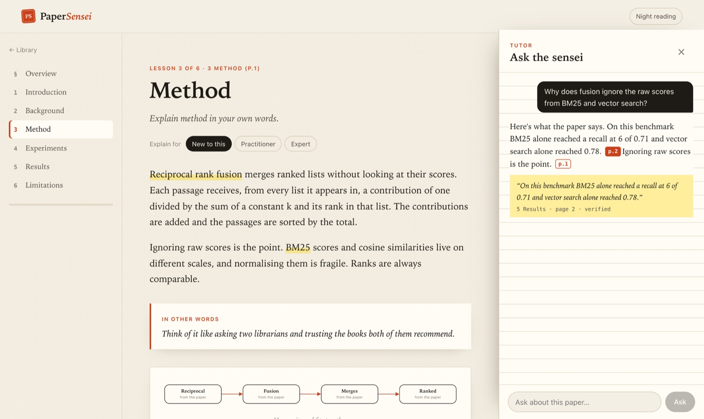
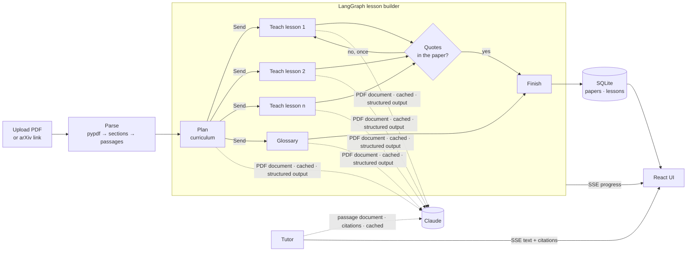

# PaperSensei

**Understand any research paper in an evening.**

Drop in a PDF or an arXiv link. PaperSensei reads every page, including the figures, and writes you a short course: plain-language lessons, a diagram for each idea, a quiz, and a glossary that pops up as you read. Every quote a lesson relies on is checked against the paper's text. A tutor answers your questions and cites the exact sentence and page it used.


https://github.com/user-attachments/assets/8b366f5a-3fe7-4e0d-999e-938c3ad36bb0


<!-- The film: drag docs/paper-sensei-promo.mp4 onto the line below in the GitHub editor. -->


## What it shows

| | |
|---|---|
| **Parallel agent workflow** | A LangGraph map-reduce: a planner designs the curriculum, then `Send` fans out one lesson writer per lesson plus a glossary writer, all running at once |
| **Self-checking output** | Each lesson must back its walkthrough with exact quotes. Quotes are verified against the parsed paper, and a lesson that fails is rewritten once with the failures pointed out |
| **Native citations** | The tutor gets the paper as a custom-content document with Claude citations on. Each cited block maps back to a section and page, and is re-verified locally |
| **Prompt caching** | The PDF and the passage document are cached, so the planner pays for the paper once and every lesson and follow-up question reads it from cache |
| **Structured outputs** | Plans, lessons, diagrams and quizzes come back as strict JSON schemas generated from Pydantic models |
| **Live progress** | The build streams over SSE. Lessons appear as each parallel worker finishes, and you can start reading the first while the rest are written |
| **Adaptive teaching** | Any lesson can be rewritten for a newcomer, a practitioner or an expert |
| **Product design** | An editorial "study desk" UI: serif reading type, highlighter glossary terms, evidence in the margin, night reading |



## Architecture



### Two ways of giving the model a document, on purpose

A lesson writer needs the **whole paper**, figures included, so it gets the original PDF as a document block. A tutor answer needs to be **traceable**, so it gets the parsed passages as a custom-content document: one content block per passage. Claude's citations then come back as block indices, which map straight to a section and a page. Both documents carry `cache_control`, so a 20-page paper costs full price once and cache-read prices after that.

There's no vector store. A paper fits comfortably in the context window, so full-context reading with citations beats retrieval here. There's no chunk to miss and no ranking to tune. [Ashariri](https://github.com/balajisriraj/ashariri), its sibling in the Lab, shows the other side: a corpus too large for one context, with hybrid retrieval.

More in [docs/architecture.md](docs/architecture.md).

## Run it

**No API key needed.** The scripted model teaches extractively from the paper's own sentences:

```bash
cd backend
uv sync
PAPERSENSEI_LLM=scripted PAPERSENSEI_SCRIPTED_DELAY=0.03 uv run papersensei serve   # API on :8000
cd ../frontend && pnpm install && pnpm dev                                        # UI on :5173
```

**With Claude:**

```bash
export ANTHROPIC_API_KEY=sk-ant-...
cd backend && uv run papersensei serve
```

**Docker:**

```bash
cp .env.example .env && docker compose up --build   # http://localhost:8080
```

**Terminal:**

```bash
uv run papersensei learn path/to/paper.pdf --level practitioner
uv run papersensei eval --verbose
```

## Tests and evals

```bash
cd backend && uv run pytest    # parsing, quote verification, graph fan-out and the rewrite loop, API
cd frontend && pnpm test       # diagram layout, citation folding, out-of-order lesson events
```

The eval suite builds lessons for the bundled sample paper, checks every lesson's structure and grounding, and asks the tutor eight questions. Each answer must cite the right section, and every citation must verify against the text. An off-paper question must get no citations at all.

```
  lessons       6/6
  tutor         8/8
  citations     14/14 verified against the paper
```

The sample paper in `backend/samples/` was written for this project, and its experiment is illustrative. `scripts/make_sample.py` regenerates it.

## The film

The promo is made in code, not screen-recorded. `promo/capture.mjs` runs the real app on the scripted model, opens the sample paper, reads a lesson, takes the quiz and asks the tutor questions the way a reader would, and saves DOM snapshots of each moment. `promo/kit/render.mjs` replays those snapshots as live HTML with a moving camera, captions and kinetic type, renders it frame by frame and adds an original score synthesised in Python (`promo/kit/score.py`).

```bash
cd promo && pnpm install
node capture.mjs        # snapshots of the real UI
node kit/render.mjs     # the film, in docs/
```

## Layout

```
backend/papersensei/
  pdf.py         PDF → sections → citable passages (heading detection, de-hyphenation, sentence windows)
  graph.py       the lesson builder: plan → Send fan-out → teach (with the grounding retry) + glossary
  grounding.py   quote verification on normalised text, with a fuzzy fallback
  llm.py         Claude: cached PDF for structured calls, citations for the tutor; scripted model
  schemas.py     Plan, Lesson, Diagram, Quiz, Glossary
  service.py     background builds, replayable event bus, tutor, arXiv import
  api.py         FastAPI + SSE
frontend/src/
  components/Diagram.tsx   layered DAG layout and SVG rendering for flow diagrams; compare tables
  components/Prose.tsx     markdown-lite with glossary highlights
  components/Tutor.tsx     streaming answers with page citations
```

---

Part of [the Lab](https://balajisriraj.com/#lab), ten agentic products by [Balaji Sri Raj](https://balajisriraj.com).
