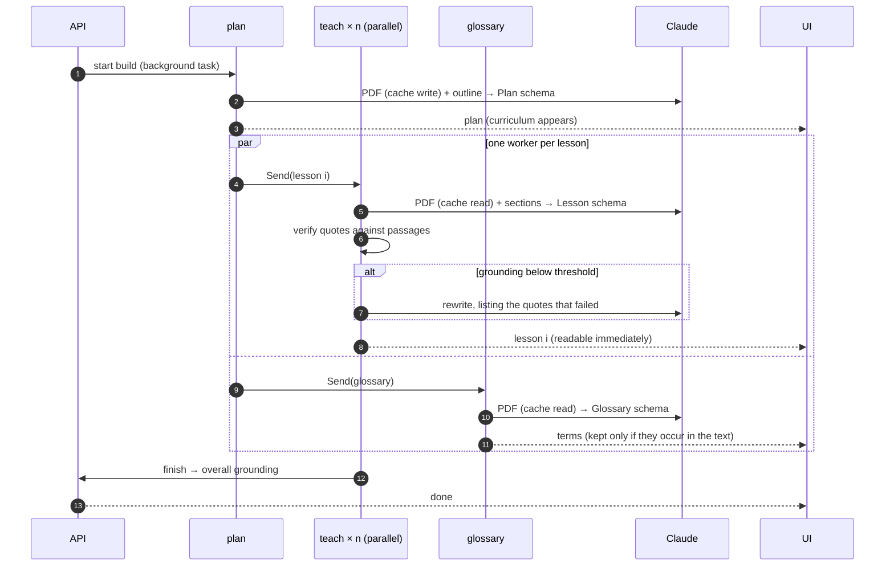

# Architecture

## From PDF to passages

`pdf.py` turns a PDF into the structure everything else depends on:

1. **Text per page** with pypdf. Encrypted, scanned (no text) and oversized papers are rejected with a clear message.
2. **Headings** are numbered lines (`3 Method`, `2.1 Setup`, `IV.`) or known section names (Abstract, Related Work, Limitations…) that are short and don't end in punctuation.
3. **Paragraphs** are rebuilt from wrapped lines. A short line ending a sentence closes a paragraph, and hyphenated line breaks are joined.
4. **Passages** are paragraphs split on sentence boundaries into windows of about 500 characters. Each passage gets a global id, its section and its page. Passages are the unit of citation.
5. **End matter.** The title block, references and acknowledgements are marked as end matter and never taught.

## The lesson builder



- **Fan-out with `Send`.** `plan` returns one `Send("teach", task)` per lesson plus `Send("glossary")`. LangGraph runs them concurrently, and their `lessons` updates merge through an `operator.add` reducer. `finish` runs once, after every branch completes.
- **Plan hygiene.** The model is given the outline and must name the sections each lesson covers. `_clean` maps those names back to real section titles (case- and punctuation-insensitive), drops invented ones, and gives any empty lesson the next untaught section.
- **Grounding loop.** Each lesson includes two to four quotes. A quote is verified when its normalised text appears in a passage (case, quotes, ligatures, hyphenation and spacing folded), or when a longest-common-run match covers at least 85% of it. If fewer than 60% verify, the lesson is regenerated once with the failing quotes listed. The final score, the attempt count and every check are stored with the lesson, and the UI shows them in the margin.
- **Rewrite by level.** `POST /lessons/{i}/rewrite` reruns one `teach` for a different audience, with the same grounding loop.

## The tutor

The passages are sent as one custom-content document:

```json
{ "type": "document",
  "source": { "type": "content", "content": [ { "type": "text", "text": "<passage 0>" }, … ] },
  "citations": { "enabled": true },
  "cache_control": { "type": "ephemeral" } }
```

The document rides on the first user turn, so the cached prefix (system prompt plus paper) is identical for every question about the same paper. Citations stream as `citations_delta` events of type `content_block_location`. The service maps `start_block_index` to a passage, adds its page and section, and checks that the `cited_text` occurs in that passage before forwarding it to the UI as verified.

Citations and structured outputs can't be combined in one request, which is why lessons (structured) and tutoring (cited) are separate calls with separate documents.

## Events

`GET /api/papers/{id}/events` streams the build. A replayable bus stores every event, so a client that connects late, or reloads mid-build, gets the history before live events.

| type | payload |
|---|---|
| `step` | `step`, `status` |
| `plan` | `plan` (title, tldr, why_it_matters, prerequisites, lessons[]), `ms` |
| `lesson_started` | `index`, `title` |
| `lesson_retry` | `index`, `grounding` |
| `lesson` | full lesson, including `quote_checks`, `grounding`, `attempts` |
| `glossary` | `terms[]` |
| `done` | `lessons`, `grounding` |
| `error` | `message` |

`POST /api/papers/{id}/ask` streams `text`, `citation` (passage, page, section, cited_text, verified) and a closing `done` with citation counts.

## Safety and limits

- PDFs only (magic-byte check), at most 25 MB and 40 pages.
- arXiv import accepts only `arxiv.org` abs or pdf URLs, rebuilds the download URL itself, does not follow redirects, and caps the download size. This blocks server-side request forgery through the URL field.
- Model output is rendered as React nodes, never as HTML.
